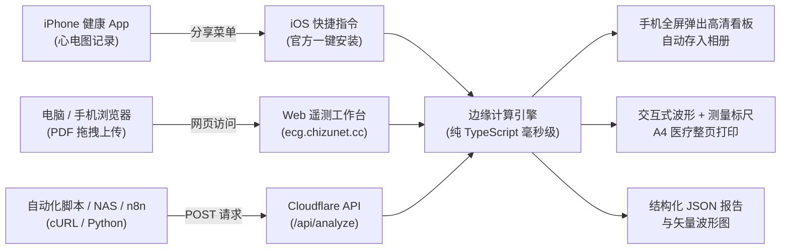

# apple_watch_ecg_web

[](https://github.com/Chizukuo/apple_watch_ecg_web/actions/workflows/ci.yml)
[](https://ecg.chizunet.cc)
[](package.json)
[](https://www.icloud.com/shortcuts/1eac247c7d264fc591c4db4239875277)
[](LICENSE)


把 Apple Watch 心电图导出的 PDF 转化为现代高密度遥测工作台与自动化流水线：提供无需安装的 Web 交互看板、iOS 快捷指令一键联动、以及纯边缘计算的 RESTful API。

> [!IMPORTANT]
> 仅供个人健康记录与对比，**不是医疗诊断**，也不是医疗器械。出现症状或对结果有疑问时，请以医生和标准 12 导联心电图为准。

---

## 算法来源与致谢

本项目的心电图提取、512 Hz 连续信号拼接、QRS 与早搏检出引擎、双基线平均心搏形态学测量以及基于 AHA/ESC 指南的临床提醒规则，均移植自开源项目：

> **上游算法项目**：[**Chizukuo / apple_watch_ecg**](https://github.com/Chizukuo/apple_watch_ecg) (Python 原版)

本项目在保持与原 Python 算法 **100% 严密数值对齐**（零误差）的前提下，基于现代 TypeScript 进行了纯原生边缘计算重构，彻底移除了原生 C++/Python 依赖与笨重运行环境，部署于 Cloudflare 全球边缘节点，实现毫秒级响应。

---

## 目录

- [在线体验](#在线体验)
- [核心应用场景](#核心应用场景)
  - [1. iOS 快捷指令一键联动 (日常最推荐)](#1-ios-快捷指令一键联动-日常最推荐)
  - [2. Web 遥测分析工作台 (高密度研判)](#2-web-遥测分析工作台-高密度研判)
  - [3. 开放 API 与自动化集成 (开发者流水线)](#3-开放-api-与自动化集成-开发者流水线)
- [Web 工作台特性](#web-工作台特性)
- [本地运行与部署](#本地运行与部署)
- [测试与对齐验证](#测试与对齐验证)
- [隐私安全](#隐私安全)
- [许可证](#许可证)

---

## 在线体验

无需配置任何本地环境或安装应用，通过任意浏览器即可直接访问：

* 生产环境站点：**[https://ecg.chizunet.cc](https://ecg.chizunet.cc)**
* API 服务地址：**`https://ecg.chizunet.cc/api/analyze`**

---

## 核心应用场景



### 1. iOS 快捷指令一键联动 (日常最推荐)

在手机上查看 Apple Watch 心电图时，无需使用电脑或手动上传，通过官方快捷指令即可在手机端实现一键全自动解析。

* **快捷指令官方获取链接**：[**点此一键获取并安装快捷指令**](https://www.icloud.com/shortcuts/1eac247c7d264fc591c4db4239875277)

#### 使用步骤：
1. **安装**：在 iPhone 或 iPad 上点击上方链接，在系统弹窗中点击「添加快捷指令」（免除手动设置任何网络参数）。
2. **分析**：
   - 打开 iPhone 自带的 **「健康」** App → 进入 **「心脏」** → **「心电图 (ECG)」**。
   - 打开任意一份 30 秒心电图记录，轻点右上角 **「分享」** 按钮。
   - 在系统分享菜单中轻点刚刚添加的 **快捷指令**。
3. **交付**：
   - 系统将自动上传 PDF 至边缘引擎并在 **数秒内全屏弹出** 交互式高精心电分析看板。
   - 可自动生成高清图片归档存入系统相册。

---

### 2. Web 遥测分析工作台 (高密度研判)

适合在电脑或平板大屏幕上对心电图进行深度研判与打印归档。

1. 打开 [https://ecg.chizunet.cc](https://ecg.chizunet.cc)。
2. 将 Apple Watch 导出的 `*.pdf` 文件直接拖拽至上传区域（或点击选择文件）。
3. 工作台即时解析并呈现：
   - **全局患者元数据带**：患者姓名、记录时年龄、精确测量时间戳、Apple Watch 硬件型号与手表报告心率。
   - **6 单元临床遥测看板**：
     - 平均心率（附 RR 极值区间）
     - QRS 波群时限（附正常生理基准比对）
     - QTc 间期（自动切换并同时提供 Bazett 与 Fridericia 双公式数值）
     - PR 间期测量
     - 心率变异性（HRV RMSSD 与 SDNN）
     - 早搏与异位搏动分类统计（提前·同形、提前·异形、形态异常、长间歇停顿）
   - **交互式高精度矢量画布**：
     - 3 段连续 10 秒的标准 25 mm/s × 10 mm/mV 医用网格心电波形。
     - 放大模板区：包含 PQ/TP 双基线对齐的平均心搏放大图与 P/Q/R/S/T 各特征点动态卡尺。
     - 庞加莱散点图（Poincaré Plot）：直观展现心律规则性与变异离散度。
   - **多格式导出与临床打印**：
     - 支持导出纯矢量 `.svg` 文件、高分辨率 `.png` 大图、以及包含完整生理指标的 `*_report.json`。
     - **专属医疗整页打印**：支持快捷键 `Ctrl+P` / `Cmd+P`，自动隐去所有网页交互控件，生成专业干净的 A4 纸质/PDF 临床就医参考档案。

---

### 3. 开放 API 与自动化集成 (开发者流水线)

本服务提供无状态 RESTful API，可无缝集成至个人自动化健康监控脚本、NAS 自动归档、Home Assistant 或 n8n 工作流中。

#### 接口定义

* **请求方式**：`POST`
* **请求路径**：`https://ecg.chizunet.cc/api/analyze`
* **数据格式**：`multipart/form-data`（上传名为 `file` 的 PDF 文件）或直接传递 PDF 二进制流。
* **URL 查询参数**：
  * `format=svg`（默认）：直接返回渲染完毕的高清矢量看板图片，`Content-Type: image/svg+xml`。
  * `format=json`：返回结构化医学指标与心搏明细，`Content-Type: application/json`。
  * `sex=male|female|unknown`：指定性别阈值（默认 `unknown`，男 450 ms / 女 460 ms）。
  * `placement=wrist|other`：手表佩戴位置（默认 `wrist`；若贴于胸腹部等非手腕位置设为 `other`，将自动跳过 ST/T 波提醒）。
  * `exclude=0-2,28-30`：手动指定排除干扰时段（单位：秒）。

#### cURL 请求示例

```bash
# 1. 直接获取高清矢量 SVG 看板
curl -X POST -F "file=@心电图.pdf" "https://ecg.chizunet.cc/api/analyze?format=svg" -o ecg_dashboard.svg

# 2. 获取包含详细心率、间期、早搏与提醒的结构化 JSON
curl -X POST -F "file=@心电图.pdf" "https://ecg.chizunet.cc/api/analyze?format=json" -o ecg_report.json
```

#### Python 请求示例

```python
import requests

with open("心电图.pdf", "rb") as f:
    res = requests.post(
        "https://ecg.chizunet.cc/api/analyze",
        params={"format": "json"},
        files={"file": f}
    )

data = res.json()
print(f"心率: {data['rhythm']['hr_bpm']} bpm")
print(f"QRS 时限: {data['morphology']['qrs_ms']} ms")
print(f"QTc (Bazett): {data['morphology']['qtc_bazett_ms']} ms")
print(f"早搏统计: 同形 {data['rhythm']['n_premature_same']} 次, 异形 {data['rhythm']['n_premature_diff']} 次")
if data.get('alerts'):
    print(f"形态提醒: {[a['text'] for a in data['alerts']]}")
```

---

## Web 工作台特性

* **严谨工业级 UI/UX**：专为心电遥测工程设计的深浅色主题，去除玩具化装饰与廉价动效，数据等宽对齐，专注高密度信息呈现。
* **毫秒级边缘执行**：优化了滑动中值滤波至 $O(N \log W)$ 并在内存中记忆化处理，整条 30 秒 15,176 点分析流程在 Cloudflare 边缘计算中以极低延迟完成。
* **零配置跨平台**：适配手机移动端、iPad 触控端以及桌面端高分辨率视网膜显示屏。

---

## 本地运行与部署

### 本地开发

需要 Node.js ≥ 20：

```bash
git clone https://github.com/Chizukuo/apple_watch_ecg_web.git
cd apple_watch_ecg_web
npm install

# 启动本地开发服务 (基于 Wrangler Pages 本地模拟器)
npm run dev
```

本地服务将在 `http://127.0.0.1:8788` 启动，完整支持 WebUI 与 `/api/analyze` 接口热重载。

### 部署到 Cloudflare Pages

本项目针对 Cloudflare Pages 进行了零配置原生适配：

1. **GitHub 自动部署（推荐）**：
   - 将本仓库 Fork 或推送至 GitHub；
   - 在 Cloudflare 控制台新建 Pages 项目并连接 GitHub 仓库；
   - 构建预设选择 **None**，根目录留空，静态产物目录填写 `public`。
2. **命令行部署**：
   ```bash
   npx wrangler pages deploy public
   ```

---

## 测试与对齐验证

本项目拥有完善的自动化测试保障，确保代码在重构与部署过程中的稳定性：

```bash
# 1. 运行原生 TypeScript 单元与管线测试
npm test

# 2. 运行与 Python 原版的端到端精度对照验证测试 (需要 Python 环境)
pytest test/test_against_web_api.py -v
```

* **原生测试**：覆盖 DSP 滤波、QRS 复合波检测、RESTful API 响应以及合成用例端到端解析（15 个测试全部绿灯通过）。
* **对齐验证**：通过 HTTP 接口逐一运行原项目的 19 个合成测试用例，比对平均心率、QRS、PR、QTc、早搏类型与形态学报警结论，与 Python 版结果完全一致。

---

## 隐私安全

* **零持久化存储**：分析过程全在内存流式执行，服务器不存储任何 PDF、波形图或解析数据，计算完成后内存立即释放销毁。
* **默认脱敏**：前端与接口在进行展示与诊断计算时严格按规则脱敏敏感身份信息。

---

## 许可证

Copyright © 2026 Chizukuo

本项目遵循 [GNU 通用公共许可证第 3 版或任何更新版本 (GPL-3.0-or-later)](LICENSE) 开源发布。按许可证第 15、16 条，本程序不提供任何担保。

*本项目与 Apple Inc. 无关，未获其认可；Apple Watch、iOS、watchOS 是 Apple Inc. 在美国及其他国家/地区的注册商标。*
